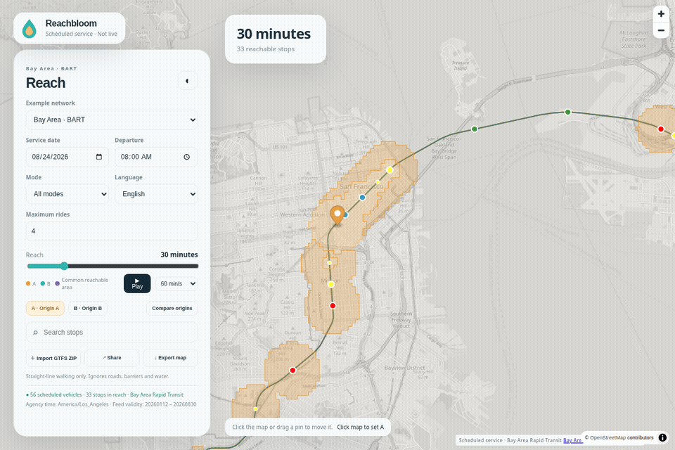
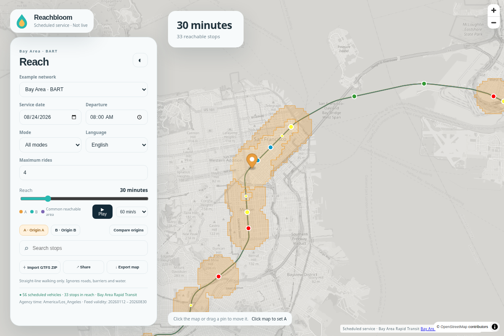
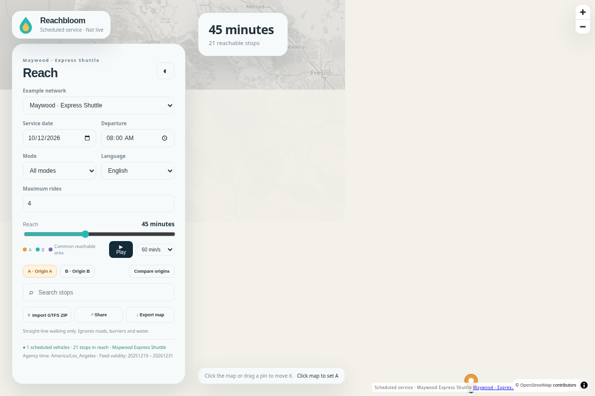
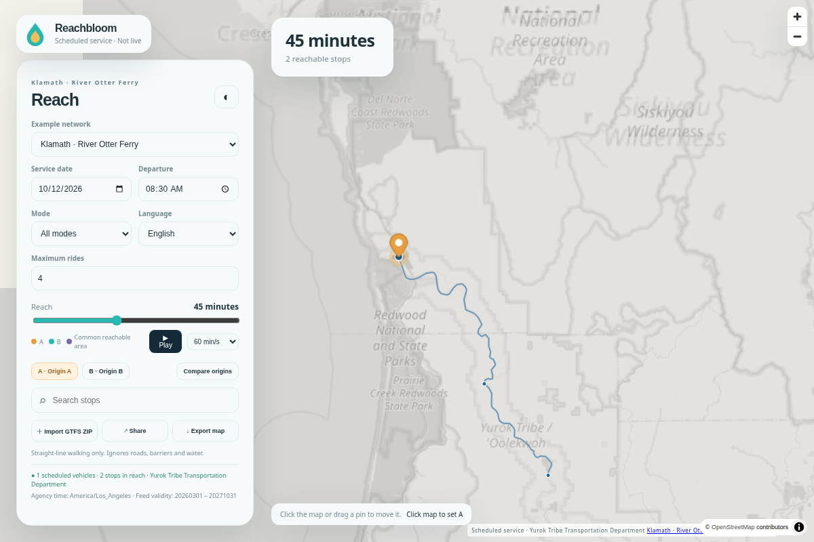

<div align="center">

<h1>Reachbloom</h1>
<p><a href="LICENSE"></a></p>
<p>Veja até onde o transporte público pode levar você em 30 minutos.</p>
<p><b>6 consultas selecionadas do BART coincidem com uma busca independente de eventos no CSV.</b> Ambas usam o modelo de caminhada documentado. Isso verifica o cálculo, não os tempos reais de viagem. <a href="benchmarks/reference-results.json">Casos e método</a>.</p>
<p><a href="https://arthur031221.github.io/Reachbloom/">Abrir o mapa</a> / <a href="docs/accuracy.md">Leia as premissas</a></p>
<p><a href="README.md">English README</a> / <a href="README.zh-TW.md">繁體中文</a> / <a href="README.zh-CN.md">简体中文</a> / <a href="README.ja.md">日本語</a> / <a href="README.ko.md">한국어</a> / <a href="README.es.md">Español</a> / <a href="README.fr.md">Français</a> / <a href="README.de.md">Deutsch</a> / <a href="README.pt-BR.md">Português</a></p>
</div>

| Antes                                                | Com Reachbloom                                                     |
| :--------------------------------------------------- | :----------------------------------------------------------------- |
| Procurar partidas em várias tabelas de horários      | Mover um marcador para ver as paradas alcançáveis                  |
| Comparar de cabeça duas casas ou horários de partida | Colocar A e B no mesmo mapa                                        |
| Enviar uma captura de tela sem contexto              | Compartilhar a data, as origens e o tempo disponível para a viagem |

```sh
npx --yes git+https://github.com/Arthur031221/Reachbloom.git
```



Um horário é um plano, não a localização em tempo real de um veículo.

## Trem, ônibus e balsa em um só mapa

<picture>
  <source media="(prefers-color-scheme: dark)" srcset="assets/hero-dark.png">
  
</picture>

_Novidade da versão 1.0: horário ferroviário com data e premissa de caminhada visível._

Abra a [demonstração ao vivo](https://arthur031221.github.io/Reachbloom/) sem conta nem chave de API. Os exemplos incluídos abrangem o trem BART, o Maywood Express Shuttle e o Yurok River Otter Ferry. São capturas de horários com data, não posições de veículos em tempo real. Importe seu próprio ZIP GTFS para explorar outra rede regional. O arquivo permanece no navegador.

Experimente este roteiro de cinco etapas no mapa:

1. Mantenha o BART em 2026-08-24 às 08:00.
2. Mova a origem A para perto do Civic Center, em San Francisco.
3. Experimente os limites de 15, 30 e 45 minutos.
4. Ative a origem B e altere o horário de partida dela.
5. Busque Powell e abra as etapas de caminhada, espera e viagem.

Laranja representa A, verde-azulado representa B e roxo representa a área alcançável por ambos. A grade estima a caminhada em linha reta e ignora ruas, barreiras e água. A área em comum pode sugerir um ponto de encontro, mas não encontra casas com deslocamento para dois locais de trabalho.

<table>
<tr><td><a href="assets/bus.png"></a></td><td><a href="assets/ferry.png"></a></td></tr>
<tr><td><i>Novidade da versão 1.0: um ônibus de bairro.</i></td><td><i>Novidade da versão 1.0: uma travessia de balsa.</i></td></tr>
</table>

## Por que criei

> _Consigo ler uma tabela de partidas. Ainda quero ver aonde aquela partida pode me levar._

Criei o Reachbloom porque queria deixar a data, o tempo de espera e as premissas de caminhada junto ao mapa. Eu queria mover um marcador, comparar outro horário de partida e compartilhar a mesma visualização. O horário pode ser consultado e o cálculo é feito no navegador.

## O que ele gera

| Saída                  | O que acompanha                                                         |
| :--------------------- | :---------------------------------------------------------------------- |
| Mapa de alcance        | Partidas datadas, estimativa a pé e limite de viagens                   |
| Link compartilhado     | As duas origens, horários, modo, tema e idioma                          |
| PNG                    | Marcadores de origem, horários de partida, limite de tempo e atribuição |
| Itinerário por paradas | Etapas de caminhada, espera e viagem com horários                       |

## Um horário que você pode percorrer

Quando disponíveis, os veículos programados seguem as formas das rotas do feed. A reprodução avança o relógio de partida para você observar as mudanças nos veículos e no alcance. Filtre trem, ônibus ou balsa, escolha de uma a oito viagens e alterne entre os temas claro e escuro.

A interface oferece inglês, chinês tradicional, chinês simplificado, japonês, coreano, espanhol, francês, alemão e português brasileiro. O layout se adapta a celulares. Ao compartilhar um exemplo incluído, o link leva a data, os horários de partida, as origens, o modo, o número de viagens, o limite, o idioma e o tema. Um ZIP importado precisa ser aberto novamente localmente. Por isso, o compartilhamento de feeds privados fica desativado.

A exportação cria um PNG de 1080 x 1350 com o mapa, os marcadores de origem, os horários de partida, o limite de tempo da viagem e a atribuição. Também inclui um aviso sobre a estimativa de caminhada. Os blocos do mapa precisam de conexão com a internet. A análise dos dados e o cálculo de itinerários são executados em workers.

## Execute no seu computador

São necessários Node.js 22.12 ou mais recente e Git. O comando acima baixa o código fonte do GitHub, compila tudo localmente e inicia um servidor em `http://127.0.0.1:4173`. A primeira execução demora mais que abrir a demonstração ao vivo.

<details>
<summary>macOS e Linux</summary>

```sh
npx --yes git+https://github.com/Arthur031221/Reachbloom.git
```

Para usar outra porta, acrescente o número ao comando: `npx --yes git+https://github.com/Arthur031221/Reachbloom.git 4180`.

</details>

<details>
<summary>Windows PowerShell</summary>

```powershell
npx --yes git+https://github.com/Arthur031221/Reachbloom.git
```

Abra `http://127.0.0.1:4173`. Pressione Ctrl+C para parar o servidor.

</details>

<details>
<summary>Compile a partir de um checkout ou hospede uma cópia estática</summary>

```sh
git clone https://github.com/Arthur031221/Reachbloom.git
cd Reachbloom
npm ci
npm run build
npx vite preview
```

Implante `dist/` em qualquer hospedagem estática. O GitHub Pages usa o workflow incluído. Consulte as instruções de [instalação](docs/install.md) e [configuração](docs/config.md).

</details>

## O que o resultado significa

O cálculo de transporte usa horários programados de partida e chegada com data, exceções do calendário e serviço que atravessa a meia-noite. Em cada rodada de viagens, verifico todas as viagens ativas, inclusive as que ultrapassam outras. A correspondência de baldeações mantém o contexto da rota e da viagem, segue a ordem de especificidade do GTFS e respeita os tempos mínimos e as proibições. Uma baldeação genérica exige dois minutos no total, incluindo a caminhada entre serviços. Não são modeladas a espera do veículo para garantir conexões nem a continuação a bordo entre viagens. Essas conexões usam uma baldeação comum conforme o horário.

A velocidade de caminhada é estimada em 4,8 km/h. O acesso e a saída a pé têm limite de 1 km. Entre viagens, há uma caminhada de baldeação de até 400 m. A grade exibida, de 120 m, mantém apenas células totalmente dentro do raio estimado de caminhada. A estimativa é conservadora na borda e não é uma isócrona baseada na rede de ruas. Paradas que exigem combinar previamente a busca ou o desembarque são excluídas dessas ações. Serviços com frequência exata são expandidos. Modelos de frequência não exata são omitidos com uma nota.

Datas próximas às mudanças do horário de verão são rejeitadas porque esta versão usa o horário local da agência. Não há atrasos em tempo real, tarifas nem rotas acessíveis para cadeiras de rodas, e não se afirma precisão equivalente à de um planejador da operadora. [Dados compatíveis e limites](docs/data-support.md) descreve as entradas rejeitadas e aproximadas.

A captura do BART informa a data final 2026-08-30, embora o calendário continue depois dela. O mapa mostra os campos de validade e avisa quando a data está fora desse intervalo. Cada feed tem sua própria licença. Consulte a [procedência dos dados](data/README.md) e os [avisos de terceiros](THIRD_PARTY_NOTICES.md).

## Verifique o trabalho

```sh
npm ci
npm run typecheck
npm test
npm run build
npm run check:ui
```

A verificação no navegador cobre o mapa real, erros de importação, os três exemplos, itinerários, nove idiomas, compartilhamento, exportação PNG e conteúdo que ultrapassa a tela no celular. Se não houver Chrome do sistema, instale o Chromium primeiro com `npx playwright install chromium`. Os testes unitários e as compilações usam Node 22 e 24 na CI. As verificações do navegador, do pacote e de referência usam Node 22.

`npm run benchmark` mede o feed incluído no seu computador. Para a verificação independente com o CSV original, crie um ambiente Python e execute `PYTHON=.venv/bin/python npm run verify:reference`. A [implementação de referência](tests/reference.py) usa busca por eventos, em vez da busca por rodadas do aplicativo. Passar em seis consultas fixas não comprova a precisão para todos os feeds.

[Uso](docs/usage.md) / [Arquitetura](docs/architecture.md) / [Precisão](docs/accuracy.md) / [Contribuição](CONTRIBUTING.md)

O código-fonte usa a licença MIT. Os dados de transporte e os blocos do mapa têm termos próprios.

Assisted by Claude/Codex.
